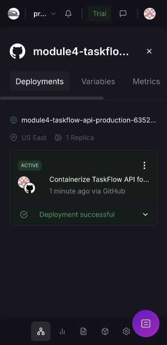
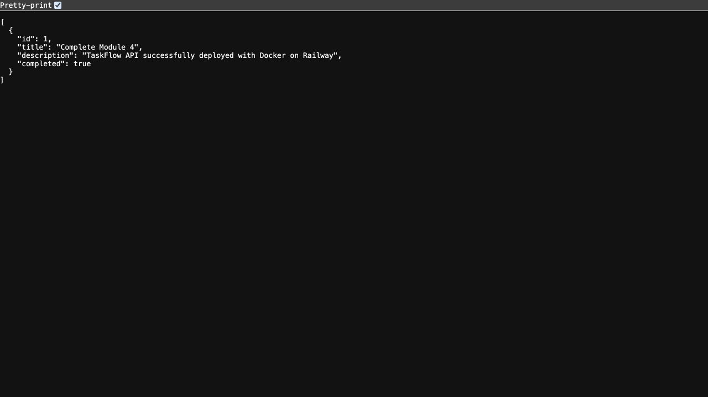

# TaskFlow API — Module 4: Dockerize & Deploy

Containerizes the Module 3 Java 21 / Spring Boot TaskFlow API with a two-stage Docker build.

## Deployment status

Local Docker build and API verification completed on 2026-10-16 (Asia/Singapore).
Railway deployment verified ACTIVE on 2026-10-16 (Asia/Singapore). Public API verified with GET 200 and POST 201.

- Live API URL: https://module4-taskflow-api-production-6352.up.railway.app/api/tasks
- GitHub repository: https://github.com/simon97153-prog/module4-taskflow-api
- Railway project: adaptable-learning
- Public domain target port: 8080




Screenshots show the initial successful deployment. Tasks are stored in memory, so subsequent redeployments reset the sample data.

## Run locally with Docker

```sh
docker build -t taskflow:assignment4 .
docker run --name taskflow-assignment4 -p 127.0.0.1:8084:8080 taskflow:assignment4
curl http://localhost:8084/api/tasks
```

Local port 8080 was already in use, so this project uses host port 8084. The application inside the container listens on 8080. If 8080 is available, the assignment's `-p 8080:8080` mapping also works.

The build stage uses Maven and Java 21 to generate the JAR inside Docker; the runtime stage contains only the JRE and application JAR. No prebuilt target directory is required. The Dockerfile follows the assignment and skips tests during packaging; tests were run separately using `mvn -B test`.

## Verification

- Maven: 4 tests passed, 0 failures, 0 errors, 0 skipped.
- Docker image built successfully: `taskflow:assignment4`.
- Running container: 10 HTTP checks passed, including create, list, get, update, complete, delete, 404 after deletion, and 400 for a blank title.
- One sample task was created after verification for local inspection.

## Deploy to Railway

1. Create a Railway project from this GitHub repository and select the `main` branch.
2. Keep the repository root as the service root; the Dockerfile is located there.
3. The application listens on Spring Boot's default port 8080; no extra environment variable was needed.
4. Wait for the deployment to become active.
5. Under Settings → Networking, generate a public domain with target port **8080**.
6. Open the live API URL above and verify JSON is returned. An empty array `[]` is valid for a freshly started application.
7. Save the active deployment and live API screenshots in `screenshots/` and include them in this README.

Railway detects a root Dockerfile automatically: https://docs.railway.com/services

## Errors and limitations

The first local container start failed because host port 8080 was occupied. Mapping host port 8084 to container port 8080 resolved it. No existing service was stopped.

Tasks are held in memory and disappear after restart or redeployment. This course demo has no authentication; use sample data only. No database is required for the mandatory TaskFlow assignment.

The initial public URL check returned 404 while the first deployment was still starting. After Railway reported ACTIVE, GET returned 200 and POST returned 201. Deployment and screenshots are complete. No optional stretch goal is claimed.

## Submission

Submit https://github.com/simon97153-prog/module4-taskflow-api to NTULearn. Because the repository is private, ensure the assessor can access it before submission.

## Module 3 API reference


Module 3 assignment, Tasks 1–5. Java 21, Maven, Spring Web, Lombok and DevTools. Generated with Spring Initializr using its current stable selection, Spring Boot 4.1.1. No Spring AI or API key is needed.

## Run

Open this folder in VS Code. With Java 21 and Maven installed:

```sh
mvn spring-boot:run
```

The API runs at `http://localhost:8080`. Stop it with Ctrl+C.

```sh
mvn test
mvn package
```

The Maven wrapper is also included (`./mvnw` on macOS/Linux or `mvnw.cmd` on Windows).

## Structure

- `model/Task`: plain Lombok POJO with id, title, description and completed.
- `repository/TaskRepository`: initialized HashMap, generated IDs and storage operations.
- `service/TaskService`: business logic, title checks and missing-task handling.
- `controller/TaskController`: HTTP endpoints and response codes.

The service and controller use constructor injection. Tasks exist only in memory and disappear when the application restarts. IDs are generated by the server. HashMap iteration order is not guaranteed.

## Endpoints

| Method | Path | Success |
|---|---|---|
| GET | `/api/tasks` | 200, all tasks |
| GET | `/api/tasks/{id}` | 200, one task |
| POST | `/api/tasks` | 201, created task and Location header |
| PUT | `/api/tasks/{id}` | 200, updated task |
| DELETE | `/api/tasks/{id}` | 200, empty body |
| PUT | `/api/tasks/{id}/complete` | 200, completed task |

Missing tasks return 404. Missing or blank titles and invalid request formats return 400. PUT replaces title, description and completed; include all fields you want to retain. The URL ID takes precedence over a body ID.

## Test with Postman

Import `TaskFlow.postman_collection.json`. Start the application, then run the requests in order. The create request saves the generated ID into the collection variable `taskId`.

1. List tasks (initially empty).
2. Create a task (201).
3. Get it by ID (200).
4. Update it (200).
5. Mark it complete (200).
6. Delete it (200).
7. Get the deleted task (404).

For POST and PUT, select Body → raw → JSON. Example:

```json
{
  "title": "Complete Module 3",
  "description": "Build and test TaskFlow",
  "completed": false
}
```

Automated API tests cover all six endpoints, persisted completion, generated IDs, missing tasks and invalid input. Postman is provided for the assignment's manual testing step.
